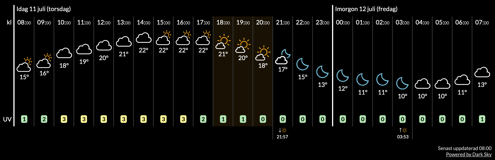

# A weather widget based on SMHI Open Data

This repo generates the below widget from weather data. This type of widget is called a [meteogram](https://en.wikipedia.org/wiki/Meteogram).

# How it works

1. Every hour `python refresh.py` fetches a forecast from [SMHI Open Data](https://opendata.smhi.se/metfcst/) and a Copernicus-based UV forecast from [Strålsäkerhetsmyndigheten](https://www.stralsakerhetsmyndigheten.se/omraden/sol-och-solarier/uv-index/). The result is saved to `weather/weather.json`.
2. When the static `index.html` file is loaded, it makes a request using [fetch](https://developer.mozilla.org/en-US/docs/Web/API/Fetch_API/Using_Fetch) to `weather.json`
3. The JSON file is passed through `transform_data` towards a format that can be used in a template
4. A [mustache](https://mustache.github.io/) template converts the transformed data to HTML
5. The index.html file reloads itself every hour to reflect the newly loaded `weather.json`

# Design choices

* index.html is a static file (easier to cache and deploy)
* Forecast data is fetched at most once per hour.
* UV data is fetched for `Sverige (Stockholm)` by default. Set `UV_LOCATION`
  and `UV_TIMEZONE` together to use another location offered by SSM.

Run `python refresh.py --force` to fetch new data even when the existing
forecast is less than one hour old.
